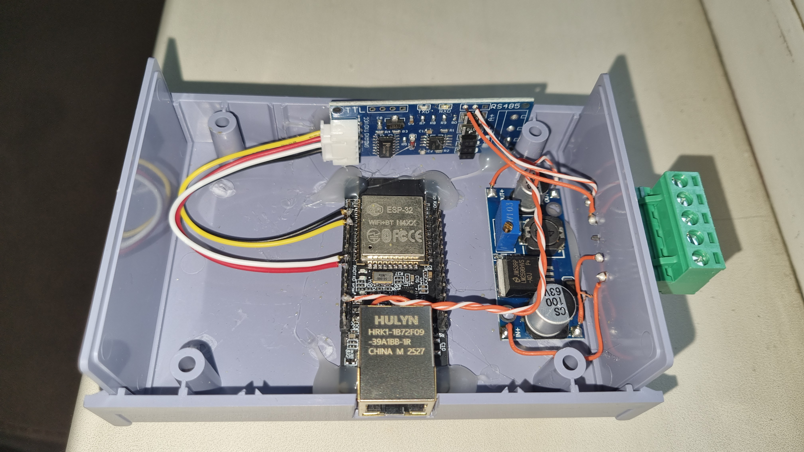
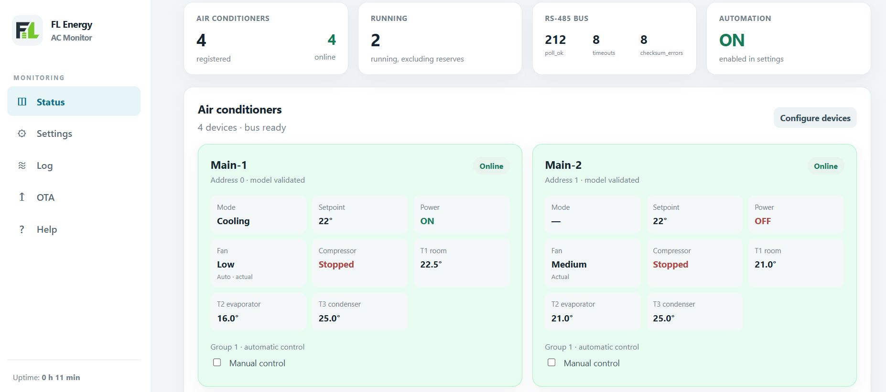
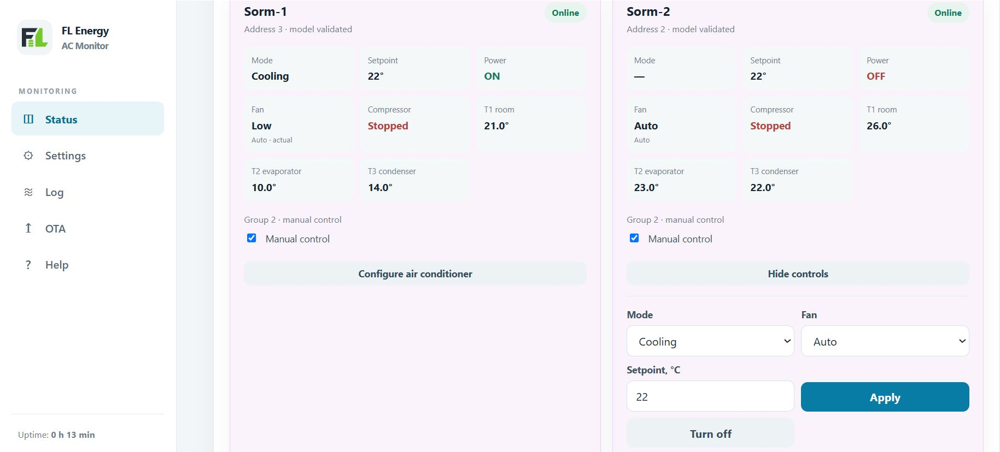

# FL Energy AC Monitor

[English](README.md) · [Русский](README.ru.md)

I built FL Energy AC Monitor to monitor and control compatible Midea air conditioners over the XYE/CCM protocol on RS-485. It runs on a WT32-ETH01 (ESP32) and provides a local web interface, network telemetry, firmware updates, and optional group automation with scheduled rotation.

**Latest firmware release: v0.7.7.** Download the firmware and release notes from [GitHub Releases](https://github.com/Slavikeks/FL_Energy_ACMonitor/releases/tag/v0.7.7).

## My controller

<p align="center"></p>

The photo shows my prototype: a WT32-ETH01, an auto-direction RS-485 transceiver, a 5 V DC-DC converter, and wired Ethernet.

## Web interface

<p align="center"></p>

<p align="center"></p>

The interface is available in Russian and English. It includes Status, Settings, Log, OTA, and Help pages, plus a formatted `/json` state view.

## Features

- Monitor and control Midea air conditioners over a shared RS-485 bus using XYE/CCM. This is **not Modbus**.
- View power, mode, setpoint, fan, compressor flag, errors, protection flags, and available temperatures.
- Use the optional read-only SNMPv2c agent, enterprise MIB, and SNMPv2c traps under FLINK LLC PEN 67213.
- Publish status and events over MQTT. The controller does not subscribe to command topics.
- Update firmware through the authenticated web OTA page with `firmware.bin`.
- Group conditioners for N-of-M operation, reserve failover, temperature response, scheduled rotation, and fan-only standby.
- Store settings and the device registry in ESP32 NVS. The firmware supports up to 16 registered conditioners and 16 groups; XYE addresses range from 0 to 63.

Automation, SNMP, and MQTT are disabled by default. The initial web login is `admin` / `admin`; changing the password is not forced. Change the password and use the controller only on a trusted local network: the web interface uses HTTP, SNMPv2c community strings are unencrypted, and MQTT uses plain TCP.

## Hardware and compatibility

The firmware is designed for a WT32-ETH01 with 4 MiB flash and an RS-485 transceiver with automatic transmit/receive direction. It is intended for Midea air conditioners with an XYE/CCM interface. I tested a four-conditioner installation with both on/off and inverter models, but I do not have a complete compatibility list. Check the readings and commands for each model before enabling automation.

Here is what I observed on my units:

- On/off conditioners report a useful compressor-running flag, but T3 is a constant 25 °C placeholder.
- Inverter conditioners report T3 correctly, but their compressor-running flag is not informative.

Available temperatures and protocol flags vary by model. A missing reading is not a real zero, and an unverified flag should not be used as a safety interlock.

## First start

The initial network configuration is static: **`10.90.90.90`**. Connect a computer to the same Ethernet subnet and open <http://10.90.90.90>. DHCP is not used for the initial address. After signing in, you can change the IP address and other network settings in Settings.

See [installation and first-start instructions](docs/INSTALLATION.md). For serial programming, use the [bilingual flashing guide](docs/FLASHING.md). The initial login is `admin` / `admin`.

## Documentation

- [Build and test](docs/BUILD.md)
- [Midea XYE wiring and bus setup](docs/XYE_CONNECTION.md)
- [Web UI and `/json`](docs/WEB_UI.md)
- [SNMP, MIB, and traps](docs/SNMP.md)
- [MQTT topics and payloads](docs/MQTT.md)
- [OTA update procedure](docs/OTA.md)
- [RotationEngine and group behavior](docs/ROTATION_ENGINE.md)
- [Architecture](docs/ARCHITECTURE.md) · [API and OID reference](docs/API.md)
- [Changelog](CHANGELOG.md) · [Third-party notices](THIRD_PARTY_NOTICES.md)

## Releases

The current public release is [v0.7.7](https://github.com/Slavikeks/FL_Energy_ACMonitor/releases/tag/v0.7.7). It includes `firmware.bin` for OTA updates, `firmware.merged.bin` for serial programming, the SNMP MIB, and SHA-256 checksums.

See the [bilingual flashing guide](docs/FLASHING.md) for instructions. Use only firmware built for the WT32-ETH01 with 4 MiB flash and the included partition layout.

## Build and test

PlatformIO platform, framework, compiler, and library versions are pinned. Install PlatformIO Core and a desktop GCC toolchain, then run:

```sh
pio test -e native
pio run -e wt32-eth01
```

See [Build and test](docs/BUILD.md) for installation instructions and build details.

## License

The project code is available under the [MIT License](LICENSE). Third-party components retain their own licenses; see [THIRD_PARTY_NOTICES.md](THIRD_PARTY_NOTICES.md). The project's MIT license does not replace notices or license terms for framework components.
