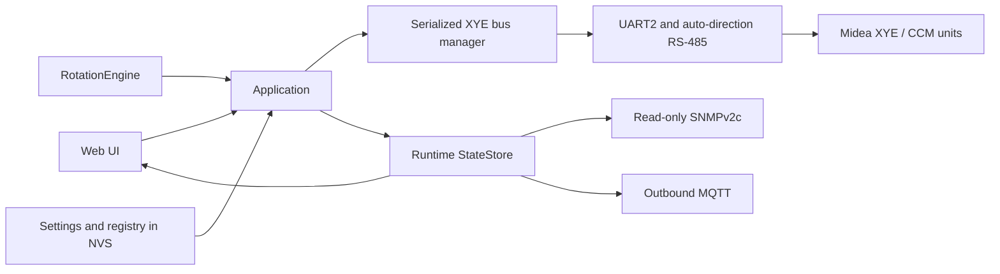

# Architecture

FL Energy AC Monitor is an embedded application for WT32-ETH01 / ESP32. Its central runtime model is owned by the application loop; the web UI, SNMP agent, and MQTT publisher observe that model rather than accessing the RS-485 bus directly.

## Data flow

Web controls and automation submit requests through the command sink. The bus manager serializes polling and commands, then reads C0 state to verify observable results. SNMP and MQTT expose observations; neither is a command path.

## Main modules

- `core`: bounded configuration and runtime state, NVS persistence, application composition, event log.
- `hal` and `xye`: UART2 transport, XYE frame codec, serialized scan/poll/command manager.
- `rotation`: group configuration codec and non-blocking state machine for AUTO groups, failover, temperature response, reserve ventilation, and schedule rotation.
- `alarm`: debounced alarm and recovery events.
- `web` and `auth`: embedded bilingual UI, authenticated API, formatted /json, and OTA endpoint.
- `snmp` and `mqtt`: read-only SNMPv2c agent/traps and outbound MQTT telemetry.
- `network`: Ethernet link and SNTP time.

The firmware runs these services from a single application loop. Runtime state and the protocol bus are bounded; credentials live in NVS and are not included in /json.

## Hardware and limits

The current transport uses WT32-ETH01 UART2 at GPIO 5 (RX) and GPIO 17 (TX), 4800 baud, 8N1. It expects an RS-485 transceiver with automatic direction control; no DE/RE GPIO is driven by the firmware.

XYE has addresses 0–63, but this firmware stores up to 16 registered conditioners and 16 groups. A scan can inspect all protocol addresses; registry capacity remains 16.

Values that are unavailable, stale, or not validated for a model are kept distinct from confirmed observations. Model-dependent protocol behavior is documented in the user and integration guides.
